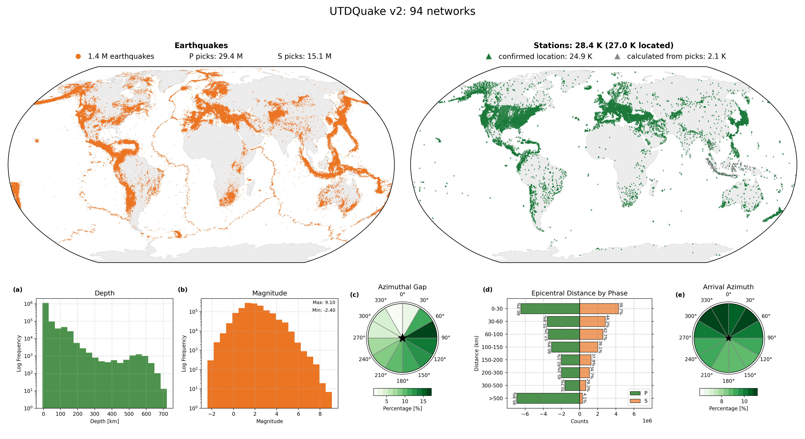
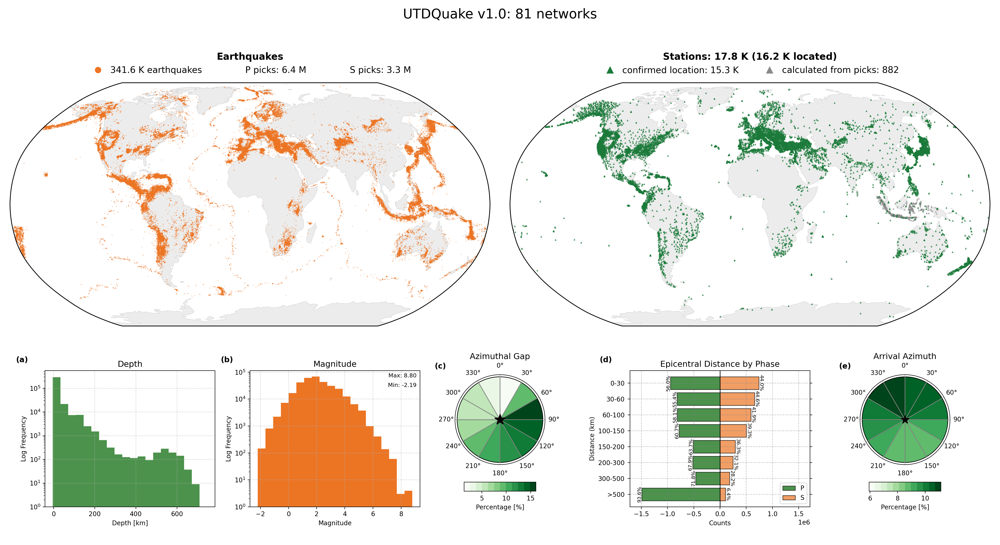

.. _versions-section:
Release versions
================

This page explains how the UTDQuake dataset is numbered, how data is added between releases, and what each
version contains. How to read a given version (``Dataset(version="v2.0")``) and where downloads are stored is
in :ref:`installation-versions-subsection`.

How versions work
-----------------

- ``main`` is the latest data: the last release plus the networks and events added since. It changes
  whenever a contribution is merged.
- A **release** is a tag on ``main`` (``v2.0``, ``v2.1``, ...). A released version never changes: read it to
  reproduce a result.
- **Minor releases** (``v2.0`` -> ``v2.1`` -> ``v2.2``) add data: new networks, more events for existing
  networks, corrections. Tables keep their columns, so code written for ``v2.0`` reads ``v2.1``.
- **Major releases** (``v2.x`` -> ``v3.0``) change the layout (columns, file names, keys) or rebuild large
  parts of the dataset; this page says what changed and how to adapt.
- The package (``utdquake`` on PyPI) has its own numbers and reads every dataset version from ``v1.0`` on.

The ``dataset_version`` column
------------------------------

Every row records the release that added it:

- ``Network`` table: the release that first added the network.
- ``Events`` and ``Picks`` tables: the release that added the event. A later release can add events to a
  network that already exists, so one network can hold events of several releases.

.. list-table::
   :header-rows: 1
   :widths: 25 75

   * - ``dataset_version``
     - Release
   * - ``v1``
     - ``v1.0``
   * - ``v2``
     - ``v2.0``
   * - ``v2.1``, ``v2.2``, ...
     - that release (from ``v2.1`` on, the label is the full release number)

So the data of a release can be selected from any later one:

.. code-block:: python

   v1_events = events[events["dataset_version"] == "v1"]          # the events of v1.0
   up_to_v2 = events[events["dataset_version"].isin(["v1", "v2"])]  # everything released in v2.0

Adding data between releases
----------------------------

1. A contributor builds a network and opens a pull request (:ref:`upload-dataset-section`). Its new events
   and picks are labelled with the **next release** automatically (after ``v2.0``: ``v2.1``), unless
   ``dataset_version`` is given.
2. The maintainers check it (travel-time model, figures, QC) and merge it into ``main``. It is then readable
   from ``main`` straight away, and listed below under the next release, "(in preparation)".
3. When a set of additions is ready, the maintainers release them: every network is checked again, the
   totals are added to this page and ``main`` is tagged (``datasets/hf_release/release.py`` does the checks,
   the upload as one pull request and the tag).

Nothing already released changes in a minor release; a fix to released data is listed with the release
that makes it.

v2.2 (in preparation)
---------------------

Networks and events added to ``main`` after ``v2.1`` are listed here until they are released.

Nothing yet.

v2.1
----

Released on 2026-11-12 (Hugging Face commit ``066786e5``): corrections to ``v2.0``, no new networks. **At a
glance:** 94 seismic networks, 1,368,025 earthquakes, 44.5 M picks, 28.4 K stations.

- **Corrections to v2.0 data.**

  - 13 events with impossible depths are removed, with their 201 picks: a default "maximum depth" of
    700.0 or 750.0 km, or a broken origin (9,330 km), in regions without deep earthquakes (``NOA`` 1,
    ``TUN`` 2, ``PRE`` 1, ``NOU`` 1, ``MDD`` 1, ``JSN`` 4, ``TIR`` 3; 5 of them were ``v1`` events). Real
    deep earthquakes (Fiji-Tonga, Sea of Okhotsk, down to 720 km) are kept.
  - 2 ``uw`` events had the placeholder magnitude -5.0; their magnitude is now empty.
  - ``R08`` (ComCat events deeper than 30 km, worldwide) gets the continent ``World``.

- **Figures.** Network maps show earthquakes sized by magnitude and coloured by depth; networks spanning
  the world get a world map. Depth histograms stop at 800 km.

v2.0
----

Released on 2026-11-11 (Hugging Face commit ``785d4c97``). **At a glance:** 94 seismic networks, 1.37 M
earthquakes (four times ``v1.0``), 44.5 M picks, 28.4 K stations; up to 20,000 events per network, new
networks ``ci`` and ``R09``-``R11`` (``R11`` synthetic), ``JMA`` with its S picks.

**Contents**

.. list-table::
   :header-rows: 1
   :widths: 40 30 30

   * -
     - Seismic
     - DAS
   * - UTDQuake networks
     - 94
     - 1 (``UWF``, as in ``v1.0``)
   * - Earthquakes (after QC)
     - 1,368,038 (336,694 ``v1``, 1,031,344 ``v2``)
     - 450
   * - Picks
     - 44,477,313
     - 7,816,115
   * - P-type picks (P / Pg / Pn)
     - 29,419,671 (23,245,031 / 2,631,929 / 3,542,689)
     - 2,930,110
   * - S-type picks (S / Sg / Sn)
     - 15,057,642 (11,804,742 / 2,124,929 / 1,127,959)
     - 4,886,005
   * - Stations (distinct ``network``, ``station``)
     - 28,429 (26,956 located, 24,853 confirmed)
     - 3 cables, 22,500 channels

The ``v1`` events are those of ``v1.0`` except ``JMA``, whose rebuilt events are all ``v2``.

**Changes from v1.0**

- **New UTDQuake networks.** ``CM`` (Servicio Geologico Colombiano), ``ci`` (Southern California Seismic
  Network, from ComCat) and the research catalogs, now with ``R`` codes:

  .. list-table::
     :header-rows: 1
     :widths: 15 25 60

     * - ``utdq_net``
       - Name before v1.0
       - ``catalog``
     * - ``R01``
       - ``ISOR``
       - COSEISMIQ
     * - ``R02``
       - ``SYN_QTM``
       - Synthetic Ridgecrest 2019 catalog
     * - ``R03``
       - ``tx_highres``
       - tx_highres (TexNet)
     * - ``R04``
       - ``GEYSERS``
       - The Geysers
     * - ``R05``
       - ``5B``
       - ToC2ME
     * - ``R06``
       - ``ESPOO``
       - ESPOO
     * - ``R07``
       - ``LASSO``
       - LASSO
     * - ``R08``
       - ``comcat_deep30``
       - ComCat events z>30km (events deeper than 30 km only)
     * - ``R09``
       - ``IPOC``
       - IPOC-Deep (Northern Chile)
     * - ``R10``
       - (new)
       - DETECT (Irpinia, Southern Italy)
     * - ``R11``
       - (new)
       - Synthetic Delaware Basin catalog (DB1D Monte Carlo)

- **More events.** The agency networks are extended to up to 20,000 events per network after quality
  control (21,000 downloaded at most), forward to November 2026 and then backwards in time to 2010. The
  new events are labelled ``v2``; the events of ``v1.0`` keep ``v1``. Sources as in ``v1.0``: ISC, USGS
  ComCat and the FDSN services of the agencies; ``NOA`` and ``IPGP`` from their own FDSN servers
  (``eida.gein.noa.gr``, ``ws.ipgp.fr``). Event and pick quality control are the same as in ``v1.0``. A few
  networks have fewer events than 20,000 because the agency has fewer events with picks (for example
  ``se``, ``UPA``, the small ISC networks).
- **JMA rebuilt.** ``JMA`` is rebuilt from the JMA bulletin ("1.3 Earthquake data", monthly hypocenter
  files) for all its events, ``v1.0`` events included, which are labelled ``v2``. ``v1.0`` read only the
  first phase of each station line, so most S picks were missing: ``JMA`` now has both the P and the S pick
  of every station line. Stations without coordinates are located from the distance and azimuth the
  bulletin gives.
- **R11, a synthetic catalog.** 21,000 synthetic events in the Delaware Basin, each with its own 1D
  velocity model drawn around DB1D, with the station geometry and pick pattern of ``R03``. How it was made:
  ``R11_catalog_description.txt`` with its figures.
- **ISC stations.** The ``IR`` stations of the new events are resolved with the ISC station registry as in
  ``v1.0``; the decisions of ``v1.0`` are reused and only new stations are decided.
- **Phase labels.** Regional phases are written ``Pg``, ``Pn``, ``Sg``, ``Sn`` in every network (some
  agencies report ``PG``, ``SN``, ...), and the phase counts include them.
- **Fixes to v1.0 data.**

  - The travel-time step of ``v1.0`` dropped every pick whose phase had no travel-time model or was not
    written exactly ``P``, ``S``, ``Pg``, ``Pn``, ``Sg``, ``Sn``. ``HEL`` (3,245 events) and ``OTT`` (2,926)
    had events left without picks; their picks are restored (labelled ``v1``). Picks are no longer dropped
    by this step.
  - ``R08`` keeps only events deeper than 30 km (one event with a revised depth of 28.8 km is removed).

- **Banks.** The QuakeML bank of every network holds its new events too. Banks are not downloaded with the
  tables any more (``download_snapshot`` and ``Network(...).events``/``picks``/``stations`` fetch only the
  tables); ``Network(...).bank`` downloads a network's bank when it is first used. Tables hold the events and
  picks after quality control; banks hold everything that was downloaded (see :ref:`dataset-section`).
- **Known limits.** Some events have no depth in their agency's bulletin (for example 5,166 new ``ANF``
  events, also some ``BYKL``, ``KRNET`` and ``MRB`` events); their picks have no hypocentral distance and no
  travel-time z-score.

v1.0
----

The dataset of the UTDQuake paper. **At a glance:** 81 seismic networks and one DAS network, 341.6 K
earthquakes, 9.7 M picks, 17.8 K stations.

**Contents**

.. list-table::
   :header-rows: 1
   :widths: 40 30 30

   * -
     - Seismic
     - DAS
   * - UTDQuake networks
     - 81
     - 1 (``UWF``)
   * - Earthquakes (after QC)
     - 341,612
     - 450
   * - Picks
     - 9,727,527
     - 7,816,115
   * - P-type picks (P / Pg / Pn)
     - 6,383,659 (4,693,985 / 737,398 / 952,276)
     - 2,930,110
   * - S-type picks (S / Sg / Sn)
     - 3,343,868 (2,421,891 / 645,592 / 276,385)
     - 4,886,005
   * - Stations (distinct ``network``, ``station``)
     - 17,844 (16,225 located, 15,343 confirmed)
     - 3 cables, 22,500 channels

**Changes from v0.3**

- **Naming.** ``utdq_net`` names the UTDQuake network (the key of every table and file,
  ``events/utdq_net=tx.parquet``); ``network`` is now the FDSN code of the station in the stations and
  picks tables; the network table gains ``catalog``, ``catalog_type``, ``networks`` and
  ``dataset_version``.
- **Stations.** Stations are keyed by ``(utdq_net, network, station)``, so two stations with the same code
  in different FDSN networks are no longer mixed. Stations that appear only in picks get a row. Totals
  over several networks count distinct ``(network, station)`` pairs.
- **ISC ``IR`` stations.** Stations reported by ISC with the placeholder code ``IR`` get their location
  and, when unambiguous, their FDSN network from the ISC station registry: about 12,800 stations are reassigned to their network and about
  26,000 get a confirmed location.
- **Phase counts.** ``p_arrivals``/``s_arrivals`` count every P-type and S-type pick, and new columns count
  each label (``p_count``, ``pg_count``, ...). Before, only picks labelled exactly ``P`` or ``S`` were
  counted.
- **Versions.** ``dataset_version`` on networks, events and picks.
- **Fixes.** Calculated station longitudes outside [-180, 180] are wrapped (47 stations) and averaged
  around the circle; maps of networks across the antimeridian (e.g. the Aleutians) are drawn correctly;
  a few bank files not in the bank index were removed and stale index rows dropped.
- **Networks.** The research catalogs and ``CM`` are not part of ``v1.0``; they are released, with ``R``
  codes, in ``v2.0``.
- **GFZ removed.** ``GFZ`` was a copy of ``GEOFON`` (the same 4,875 events, picks and stations) and is no
  longer a UTDQuake network; ``GEOFON`` keeps the data. The tag ``v1.0`` was moved on 2026-11-01; the
  first ``v1.0``, with ``GFZ``, can still be read with ``revision="f776932f988b4d797503fb2cc276b9726c4eddaa"``.
- **JAPAN renamed JMA.** The UTDQuake network of the Japan Meteorological Agency is ``JMA`` (it was
  ``JAPAN``); its station network code stays ``JAPAN`` (JMA stations have no FDSN network code). The tag ``v1.0``
  was moved again on 2026-11-02 (to ``c5370c8d``); ``v1.0`` with ``JAPAN`` and without ``GFZ`` is commit
  ``087e331b``.

v0.3
----

The dataset as published before version 1.0 (files ``network=<name>.parquet``), read by ``utdquake``
0.3. It is kept as a tag so that earlier results can be reproduced.
